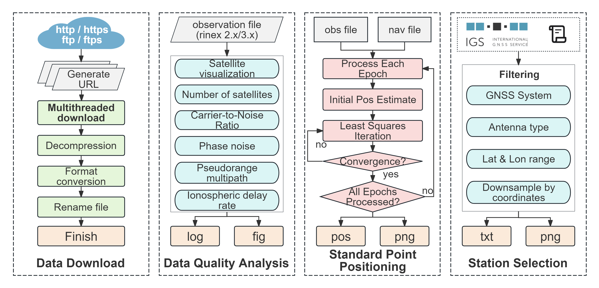

<!-- 
  ╔═══════════════════════════════════════════════════════════════════════════╗
  ║                         FAST GNSS TOOLKIT                                 ║
  ║              File Download and Signal Processing Toolkit                  ║
  ╚═══════════════════════════════════════════════════════════════════════════╝
-->

<p align="right">
  <b>English</b> | <a href="README_CN.md">简体中文</a>
</p>

<div align="center">

<h1>FAST — GNSS Data Download & Signal Processing Toolkit</h1>

<p>
  <a href="https://github.com/ChangChuntao/FAST/releases/tag/v3.01.0">
    
  </a>
  <a href="https://www.python.org/downloads/">
    
  </a>
  <a href="LICENSE">
    
  </a>
</p>

<p>
  
  
  
</p>

<p><em>Flexible And Swift Toolkit for GNSS Data — by AIR, Chinese Academy of Sciences</em></p>

<p>
  <b><a href="#-overview">🎯 Overview</a></b> •
  <b><a href="#-features">✨ Features</a></b> •
  <b><a href="#-quick-start">🚀 Quick Start</a></b> •
  <b><a href="#-installation">🔧 Installation</a></b> •
  <b><a href="#-project-structure">📁 Project Structure</a></b> •
  <b><a href="#-version-history">📝 Version History</a></b>
</p>

</div>


## 🎯 Overview

FAST (**F**lexible **A**nd **S**wift **T**oolkit for GNSS Data) is an open-source GNSS data processing toolkit covering **data download, quality check, standard point positioning (SPP), and station selection**, available in both GUI and CLI forms.



<div align="center">

| Version | Organization | Language | Interface |
|:---:|:---|:---:|:---:|
| **v3.01.00** | AIR, Chinese Academy of Sciences | Python 3 | GUI + CLI |

</div>


---

## ✨ Features

### 📥 Data Download `src/fast/download/`

- **Multi-threaded downloading** with automatic queue management and resume support
- **Smart detection** of local duplicates and download integrity verification
- **Automatic post-processing**: decompress, convert, concatenate and rename after download
- **Data types**: BRDC broadcast ephemeris · SP3 precise ephemeris · CLK clock products · OBS observation data · ERP Earth rotation parameters · DCB/OSB bias products · ION/TRO atmospheric products · SINEX solutions
- **Data sources**: IGS and major analysis centers (WHU, COD, GRG, GFZ, IAC, JAX, SHA, etc.)

### 🔍 Quality Check `src/fast/qc/`

| Module | Function |
|:---:|:---|
| `satNum` | Satellite observation counts and availability |
| `noise` | Pseudorange/carrier-phase noise via third-order difference of GF combination |
| `CNR` | Carrier-to-Noise Ratio analysis |
| `cycleSlip` | Cycle slip detection and statistics |
| `IOD` | Ionospheric delay variation rate |
| `multipath` | Turboedit multipath computation |
| `CMC` | Code minus Phase computation |
| `highOrderDiff` | High-order difference analysis |
| `obsFreq` | Observation frequency statistics |

### 📍 SPP Positioning `src/fast/spp/`

- Dual-frequency ionosphere-free pseudorange positioning
- GPS, BDS and Galileo support
- Full pipeline: observation initialization → satellite position computation → atmospheric corrections → least-squares solution
- Multiple output formats

### 🗺️ Station Selection `src/fast/site/`

- Station filtering and thinning over the global IGS network (`thinning.py`)
- Interactive map visualization (`plotSite.py`)

### 🖥️ GUI `src/fast/qt/`

A PyQt5-based graphical interface integrating download, QC, SPP, station selection and time conversion, with dark theme and custom font support.

---

## 🚀 Quick Start

### 📥 Download Pre-built Binaries

<div align="center">

<table>
<thead>
<tr>
<th>Platform</th>
<th>GUI Version 📦</th>
<th>CLI Version 🖥️</th>
</tr>
</thead>
<tbody>
<tr>
<td><b>Windows</b></td>
<td><a href="https://github.com/ChangChuntao/FAST/releases/download/v3.01.0/FastQt_Win.zip">FastQt_Win.zip</a></td>
<td><a href="https://github.com/ChangChuntao/FAST/releases/download/v3.01.0/FAST_Win.zip">FAST_Win.zip</a></td>
</tr>
<tr>
<td><b>macOS (Intel)</b></td>
<td><a href="https://github.com/ChangChuntao/FAST/releases/download/v3.01.0/FastQt_Mac.zip">FastQt_Mac.zip</a></td>
<td><a href="https://github.com/ChangChuntao/FAST/releases/download/v3.01.0/FAST_Mac.zip">FAST_Mac.zip</a></td>
</tr>
<tr>
<td><b>Ubuntu</b></td>
<td>—</td>
<td><a href="https://github.com/ChangChuntao/FAST/releases/download/v3.01.0/FAST_Ubuntu.zip">FAST_Ubuntu.zip</a></td>
</tr>
<tr>
<td><b>CentOS</b></td>
<td>—</td>
<td><a href="https://github.com/ChangChuntao/FAST/releases/download/v3.01.0/FAST_CentOS.zip">FAST_CentOS.zip</a></td>
</tr>
</tbody>
</table>

</div>

### 🐍 Run from Source

No `.pth` configuration required — just run from the repository root.

<details>
<summary><b>🐧 Linux / 🍎 macOS</b></summary>

```bash
# 1. Clone repository
git clone https://github.com/ChangChuntao/FAST.git && cd FAST

# 2. Setup environment
python -m venv venv
source venv/bin/activate
pip install PyQt5 qdarkstyle qbstyles numpy matplotlib cartopy psutil

# 3. Run
python src/_fast.py      # CLI
python src/_fastQt.py    # GUI
```
</details>

<details>
<summary><b>🪟 Windows</b></summary>

```batch
:: 1. Clone repository
git clone https://github.com/ChangChuntao/FAST.git && cd FAST

:: 2. Setup environment
python -m venv venv
venv\Scripts\activate
pip install PyQt5 qdarkstyle qbstyles numpy matplotlib cartopy psutil

:: 3. Run
python src\_fast.py      :: CLI
python src\_fastQt.py    :: GUI
```
</details>

---

## 🔧 Installation

### Requirements

<div align="center">

| Package | Purpose |
|:---:|:---|
| PyQt5 | GUI framework |
| numpy | Numerical computing |
| matplotlib | Plotting |
| cartopy | Map visualization |
| qdarkstyle | Dark theme |
| qbstyles | Plot styles |
| psutil | Process monitoring |

</div>

```bash
pip install PyQt5 qdarkstyle qbstyles numpy matplotlib cartopy psutil
```

---

## 📁 Project Structure

```
FAST/
├── src/                       # Source code
│   ├── _fast.py               # CLI entry
│   ├── _fastQt.py             # GUI entry
│   │
│   ├── fast/                  # Core package
│   │   ├── com/               # Common utilities (time/coordinate/file I/O/version)
│   │   ├── download/          # Data download module
│   │   ├── qc/                # Quality check module
│   │   ├── spp/               # SPP module
│   │   ├── site/              # Station selection module
│   │   ├── qt/                # PyQt5 GUI
│   │   ├── plot/              # Plotting module
│   │   └── bin/               # Third-party tools (crx2rnx/teqc/gzip etc.)
│   │
│   └── win_bin/               # UI resources (fonts/icons/config)
│
├── 📖 manual/                  # User manual (PDF)
├── 📂 sample_data/             # Example data
└── 📦 winVenv/                 # Windows virtual environment
```

---

## 📦 Module Reference

### Common Utilities `src/fast/com/`

| File | Purpose |
|:---|:---|
| `pub.py` | Common functions (formatting/logging/dirs) and version history |
| `gnssParameter.py` | GNSS system parameters |
| `gnssTime.py` | Time system conversions |
| `readNav.py` / `readObs.py` | Navigation / observation file readers |
| `writeClk.py` / `writeObs.py` / `writeSiteInf.py` | Clock / observation / site info writers |
| `xyz2blh.py` / `xyz2neu.py` / `xy2azi.py` | Coordinate transformations |
| `nav2posclk.py` | Broadcast ephemeris → satellite position & clock |
| `sat2siteAngle.py` | Satellite-station geometry (elevation/azimuth) |
| `mgexInf.py` / `mgexSite.py` | MGEX product info / site info |
| `readSiteinfo.py` | Site info file reader |

### Download Module `src/fast/download/`

| File | Purpose |
|:---|:---|
| `mode.py` | Main controller (interactive / command-line mode) |
| `download.py` | Core download logic |
| `ftpSrc.py` / `loadFtpSrc.py` | FTP source configuration and loading |
| `menu.py` | Interactive menus |
| `arg.py` | Command-line argument parsing |
| `dataInf.py` / `inf.py` | Data info management |
| `fileOperation.py` | File post-processing (decompress/convert/concatenate) |

### Quality Check `src/fast/qc/`

One module per file — see the feature table above (`satNum.py` / `noise.py` / `CNR.py` / `cycleSlip.py` / `IOD.py` / `multipath.py` / `CMC.py` / `highOrderDiff.py` / `obsFreq.py`).

### SPP Positioning `src/fast/spp/`

| File | Purpose |
|:---|:---|
| `sppbybrdc.py` | Broadcast-ephemeris SPP main program (`spp()` / `sppLsq()` / `writePosData()`) |
| `initObs.py` | Observation initialization |
| `satPos.py` | Satellite position computation |
| `corr.py` | Error corrections (relativity/tides etc.) |
| `trop.py` | Tropospheric delay correction |

### Station Selection `src/fast/site/`

| File | Purpose |
|:---|:---|
| `thinning.py` | Station thinning (grid-density resampling) |

### GUI `src/fast/qt/`

| File | Purpose |
|:---|:---|
| `qtFrame.py` | Frameless main window (title bar / window controls) |
| `qtInitUI.py` | UI initialization entry |
| `qtDownload.py` / `qtQc.py` / `qtSpp.py` / `qtSite.py` | Module-specific operation panels |
| `timeTran.py` | Time conversion panel |
| `qtStyle.py` | UI styling |

### Plotting `src/fast/plot/`

`plotSatNum` / `plotCnr` / `plotCMC` / `plotCycleSlip` / `plotFreq` / `plotHighOrderDiff` / `plotIOD` / `plotLnoise` / `plotMultipath` / `plotSite` — graphical output for each quality analysis result.

---

## 📝 Version History

<div align="center">

| Version | Date | Version | Date | Version | Date |
|:---:|:---:|:---:|:---:|:---:|:---:|
| 1.00 | 2022-03-27 | 1.15 | 2022-07-03 | 2.05 | 2022-12-04 |
| 1.10 | 2022-04-12 | 1.16 | 2022-07-13 | 2.06 | 2023-01-14 |
| 1.11 | 2022-04-22 | 1.17 | 2022-07-22 | 2.07 | 2023-02-10 |
| 1.12 | 2022-04-30 | 1.18 | 2022-07-28 | 2.08 | 2023-03-17 |
| 1.13 | 2022-05-24 | 1.19 | 2022-08-04 | 2.09 | 2023-06-30 |
| 1.14 | 2022-05-31 | 1.20 | 2022-09-11 | 2.10 | 2023-08-11 |
| 1.21 | 2022-09-16 | 1.22 | 2022-09-20 | 2.11 | 2023-09-20 |
| 1.23 | 2022-09-28 | 1.24 | 2022-10-10 | 1.25 | 2022-11-02 |
| 2.01 | 2022-11-09 | 2.02 | 2022-11-10 | 2.03 | 2022-11-15 |
| 2.04 | 2022-12-02 | 3.00.01 | 2024-01-09 | 3.00.02 | 2024-05-22 |
| 3.00.03 | 2025-08-02 | **3.01.00** | 2026-03-17 | | |

</div>

---

## 👥 Development Team

<div align="center">

| Role | Contributor | Affiliation | Contributions |
|:---:|:---:|:---|:---|
| **Project Lead** | Dr. Chang Chuntao | AIR, Chinese Academy of Sciences | Architecture, Core Development, Documentation |
| **Algorithm Expert** | Pd. Jiang Kecai | GNSS Research Center, Wuhan University | Parallel Computing Optimization |
| **Core Developer** | Dr. Mu Renhai | GNSS Research Center, Wuhan University | Testing, User Documentation |
| **Quality Assurance** | Pd. Li Bo | Liaoning Technical University | Testing, User Documentation |
| **Technical Support** | Dr. Wei Hengda | GNSS Research Center, Wuhan University | Validation, Tutorial Materials |

</div>

---

## 📖 Documentation

- 📄 [Complete Manual](./manual/FAST_manual-V3.00.pdf)
- 🐛 [Issue Tracker](https://github.com/ChangChuntao/FAST/issues)

---

## 📧 Contact

<div align="center">

**Dr. Chang Chuntao** — changchuntao@aircas.ac.cn

AIR, Chinese Academy of Sciences

</div>

---

<div align="center">

<p>
  <a href="https://github.com/ChangChuntao/FAST">🐙 GitHub</a> •
  <a href="https://gitee.com/changchuntao/FAST">🔗 Gitee</a>
</p>

<p>
  
  
</p>

<br>
<sub>© 2022-2026 FAST Development Team</sub>

</div>
